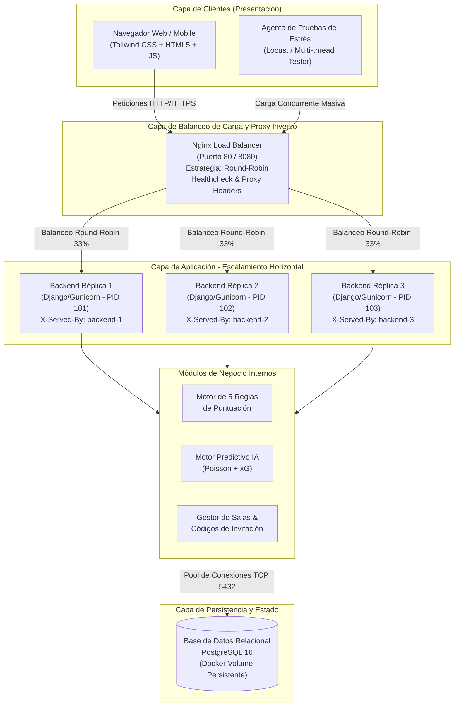
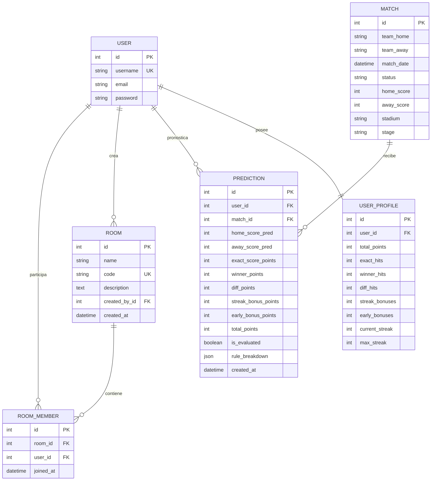
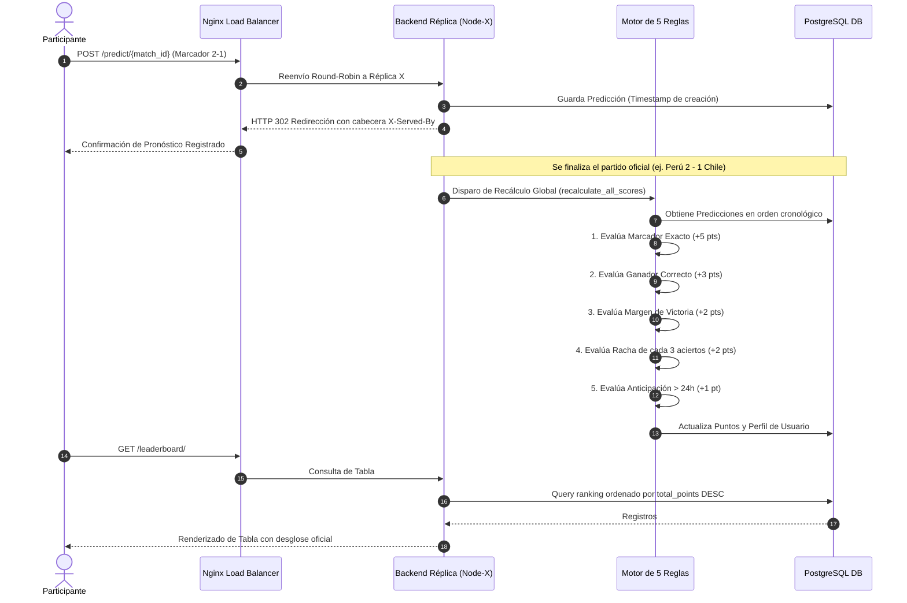

# PROPUESTA DE ARQUITECTURA DEL SISTEMA
## Plataforma de Predicciones del Mundial de Fútbol (Quiniela / Polla Mundialista)

---

### 1. Resumen Ejecutivo
El presente documento describe la arquitectura de software propuesta para la aplicación de predicciones de partidos del Mundial de Fútbol. La solución está diseñada bajo un enfoque de **sistemas distribuidos**, **alta disponibilidad**, **desacoplamiento modular** y **escalabilidad horizontal elástica**.

El sistema permite a los participantes registrar pronósticos para los encuentros del torneo, organizarse en **Salas Privadas (Grupos)** mediante códigos alfanuméricos únicos de invitación, competir en una **Tabla de Posiciones Global y por Salas**, y consultar **estadísticas predictivas impulsadas por Inteligencia Artificial** (modelo bivariado de Poisson y cálculo de Expected Goals - xG). Asimismo, implementa con total rigor un motor de evaluación basado en **5 reglas de puntuación oficiales**.

---

### 2. Diagrama de Arquitectura Global del Sistema

El flujo general de componentes y el balanceo de carga se estructura en un modelo multicapa:



---

### 3. Componentes del Sistema

#### 3.1. Capa de Presentación (Frontend)
- **Tecnología**: Interfaz web responsiva con **HTML5**, **Tailwind CSS (Dark World Cup Theme)** y **JavaScript asíncrono**.
- **Características**:
  - Panel interactivo para el registro y actualización de marcadores pronosticados.
  - Indicador dinámico de nodo activo: muestra en cabecera y pie de página el servidor que atendió la petición (`X-Served-By: backend-replica-X`), comprobando el balanceo de carga en tiempo real.
  - Modal interactivo con telemetría de IA: gráficos y probabilidades para cada encuentro (Victoria Local %, Empate %, Victoria Visitante %, Top 3 marcadores Poisson).
  - Módulo de Salas con generación de códigos de invitación y copia en un clic.

#### 3.2. Capa de Balanceo de Carga y Proxy Inverso (Nginx)
- **Estrategia de balanceo**: **Round-Robin** equitativo entre las réplicas backend disponibles.
- **Funcionalidades clave**:
  - Terminación y enrutamiento HTTP en puertos 80 y 8080.
  - Inyección y preservación de cabeceras de trazabilidad: `X-Forwarded-For`, `X-Real-IP`, `X-Served-By`, `X-Process-PID`.
  - Servidor de archivos estáticos optimizado con directivas de caché `Cache-Control`.
  - Monitoreo continuo del estado de las réplicas mediante sondeo de salud (`/lb-health` y `/api/health/`). En caso de caída de una réplica, es excluida temporalmente sin interrumpir a los usuarios.

#### 3.3. Capa de Aplicación (Backend Replicable)
- **Tecnología**: **Python 3.12 / 3.14** con **Django Framework**, **Django REST Framework** y servidor de producción **Gunicorn** (con 3 workers por contenedor).
- **Escalabilidad Horizontal**: Cada réplica se ejecuta como un contenedor sin estado (*stateless*). Cualquier réplica puede procesar cualquier solicitud, ya que las sesiones y autenticaciones se resuelven a nivel de base de datos compartida.
- **Middleware de Identidad**: `ServerIdentityMiddleware` inspecciona el entorno y adjunta a las cabeceras HTTP la identificación única del contenedor y su PID del sistema operativo.

#### 3.4. Capa de Datos (Persistencia Relacional)
- **Tecnología**: **PostgreSQL 16 Alpine** (en contenedor Docker con volumen montado para persistencia entre reinicios). Para entornos de desarrollo local rápido sin dependencias externas, el sistema conmuta automáticamente a **SQLite3**.
- **Integridad**: Llaves foráneas con restricciones en cascada, índices únicos compuestos en `(user_id, match_id)` para garantizar una única predicción por partido, e índices de alto rendimiento en códigos de sala y puntajes acumulados.

---

### 4. Modelo de Datos (Diagrama Entidad-Relación)



---

### 5. Diagrama de Secuencia: Envío y Evaluación de Predicciones



---

### 6. Estrategia de Escalamiento Horizontal

1. **Sin Estado (*Stateless Servers*)**: Los servidores de backend no almacenan estado en memoria ni en disco local; delegan la persistencia en la base de datos PostgreSQL. Esto permite añadir o remover réplicas sin desconectar usuarios.
2. **Elasticidad con Docker Compose**:
   ```bash
   docker-compose up --scale backend=3 -d
   ```
   El balanceador Nginx consulta dinámicamente al servicio `backend` a través del resolvedor DNS interno de Docker (127.0.0.11), distribuyendo las conexiones concurrentes.
3. **Resiliencia ante Fallos**: Si un contenedor sufre una detención imprevista, la política de salud de Nginx detecta el código de error y redirige inmediatamente el tráfico hacia los contenedores operativos.
