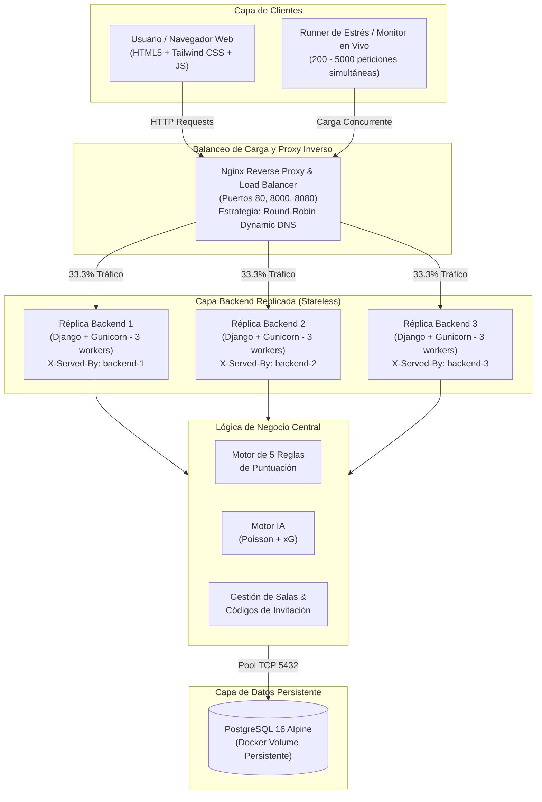

# 🏆 FIJAS INFINITAS - PLATAFORMA DE PREDICCIONES MUNDIAL 2026
### Arquitectura Distribuida, Escalamiento Horizontal, Balanceo de Carga y Motor Predictivo de IA

[](https://www.python.org/)
[](https://www.djangoproject.com/)
[](https://www.docker.com/)
[-009639?style=for-the-badge&logo=nginx&logoColor=white)](https://nginx.org/)
[](https://www.postgresql.org/)
[](https://tailwindcss.com/)

> **Proyecto Universitario - Laboratorio Calificado**: Diseño e implementación de un sistema distribuido de alta concurrencia para la quiniela / polla de la Copa Mundial FIFA 2026, con balanceo de carga en 3 réplicas backend, base de datos relacional PostgreSQL, pruebas de saturación y punto de quiebre, y telemetría de IA.

---

## 📌 Tabla de Contenidos
1. [Características Principales](#-características-principales)
2. [Arquitectura del Sistema](#-arquitectura-del-sistema)
3. [Las 5 Reglas Oficiales de Puntuación](#-las-5-reglas-oficiales-de-puntuación)
4. [Inicio Rápido](#-inicio-rápido)
   - [Opción A: Docker Compose (3 Réplicas + Nginx + PostgreSQL)](#opción-a-despliegue-con-docker-compose-recomendado)
   - [Opción B: Demostración Clúster Local sin Docker](#opción-b-demostración-clúster-local-sin-docker)
   - [Opción C: Ejecución Directa en Host (Monolito)](#opción-c-ejecución-directa-en-host)
5. [Herramientas de Monitoreo y Pruebas de Estrés](#-herramientas-de-monitoreo-y-pruebas-de-estrés)
   - [Monitor Web en Vivo](#1-monitor-web-de-estrés-en-vivo)
   - [Prueba de Punto de Quiebre (Breaking Point)](#2-prueba-de-punto-de-quiebre-breaking-point-test)
   - [Prueba Unitaria de las 5 Reglas](#3-pruebas-unitarias-automatizadas)
6. [Cuentas y Datos de Demostración](#-cuentas-y-datos-de-demostración)
7. [Estructura del Proyecto](#-estructura-del-proyecto)
8. [Documentación y Entregables](#-documentación-y-entregables)

---

## 🚀 Características Principales

* **Escalamiento Horizontal Multi-Contenedor**: Clúster de 3 réplicas del backend Django atendidas por un balanceador de carga Nginx configurado con algoritmo **Round-Robin**.
* **Monitor de Carga Visual en Tiempo Real**: Dashboard web interactivo en `/monitor/` para visualizar la distribución equitativa de peticiones entre las réplicas (`backend-1`, `backend-2`, `backend-3`) y medir el Throughput (RPS) y latencia.
* **Prueba de Punto de Quiebre (Breaking Point)**: Suite que somete la aplicación desde 200 hasta 5,000 peticiones concurrentes para determinar la capacidad máxima y saturación de la arquitectura.
* **Salas Privadas con Códigos de Invitación**: Sistema que permite a los usuarios crear salas (ej. `WC26-UNISYS`), invitar amigos y disputar clasificaciones exclusivas.
* **Motor Predictivo de Inteligencia Artificial**: Modelo estadístico bivariado de **Poisson** y cálculo de **Expected Goals (xG)** que provee probabilidades 1X2, marcadores más probables y recomendaciones tácticas para cada encuentro.
* **Trazabilidad Total**: Inyección de cabeceras HTTP `X-Served-By` y `X-Process-PID` para certificar qué nodo procesó cada solicitud.

---

## 🏗 Arquitectura del Sistema



---

## 🎯 Las 5 Reglas Oficiales de Puntuación

El motor implementado en [`core/scoring.py`](file:///c:/Users/ANDERSON/Downloads/lab12/core/scoring.py) evalúa matemáticamente cada predicción con 100% de rigurosidad:

1. **Regla 1 - Marcador Exacto (5 puntos)**: Se otorga al acertar exactamente la cantidad de goles de ambos equipos (ej. predice `2-1` y el resultado final es `2-1`).
2. **Regla 2 - Ganador Correcto (3 puntos)**: Se otorga al acertar el equipo vencedor o el empate, sin requerir el marcador exacto (ej. predice `3-0` y termina `1-0`).
3. **Regla 3 - Margen / Diferencia de Goles Correcta (2 puntos)**: Se otorga al acertar la diferencia exacta de goles entre ambos equipos. En combinación con la Regla 2 suma 5 puntos base (ej. predice `3-1` [+2] y termina `2-0` [+2]).
4. **Regla 4 - Bonus por Racha (+2 puntos extra)**: Por cada racha de **3 partidos consecutivos acertados**, el participante recibe 2 puntos de bonificación adicionales acumulables.
5. **Regla 5 - Bonificación por Predicción Anticipada (+1 punto extra)**: Si el pronóstico se registra con más de **24 horas de antelación** al inicio del partido, se premia con 1 punto adicional. Las predicciones registradas a última hora solo acumulan puntos base.

---

## ⚡ Inicio Rápido

### Opción A: Despliegue con Docker Compose (Recomendado)

Requiere [Docker Desktop](https://www.docker.com/products/docker-desktop/) en ejecución.

```powershell
# 1. Clonar el repositorio
git clone <URL_DE_TU_REPOSITORIO>
cd lab12

# 2. Levantar el clúster con 3 réplicas del backend y balanceador Nginx
docker-compose up --build --scale backend=3 -d
```

Acceder en el navegador:
* **Aplicación Principal**: [http://localhost:8000](http://localhost:8000) (o [http://localhost:80](http://localhost:80))
* **Monitor de Estrés en Vivo**: [http://localhost:8000/monitor/](http://localhost:8000/monitor/)
* **Salud del Clúster (API)**: [http://localhost:8000/api/health/](http://localhost:8000/api/health/)

Para detener el clúster:
```powershell
docker-compose down
```

---

### Opción B: Demostración Clúster Local sin Docker

Si deseas probar el balanceo Round-Robin sin levantar Docker Desktop:

```powershell
python cluster/run_cluster.py
```
Este orquestador inicia automáticamente:
* Réplica 1: `http://127.0.0.1:8001`
* Réplica 2: `http://127.0.0.1:8002`
* Réplica 3: `http://127.0.0.1:8003`
* Balanceador Round-Robin: `http://127.0.0.1:8000`

---

### Opción C: Ejecución Directa en Host

```powershell
# 1. Instalar requerimientos
pip install -r requirements.txt

# 2. Migrar base de datos y cargar datos iniciales
python manage.py migrate
python manage.py seed_data

# 3. Iniciar servidor de desarrollo
python manage.py runserver 127.0.0.1:8000
```

---

## 🧪 Herramientas de Monitoreo y Pruebas de Estrés

### 1. Monitor Web de Estrés en Vivo
Ingresa a `http://localhost:8000/monitor/`:
* Selecciona desde **60 hasta 5,000 peticiones** y hasta **100 hilos concurrentes**.
* Presiona **"Ejecutar Prueba en Vivo"** y observa cómo las barras de las 3 réplicas se llenan simultáneamente al 33.3% cada una.
* Visualiza la telemetría de throughput (req/s), latencia media en ms y el stream de peticiones atendidas por cada contenedor.

### 2. Prueba de Punto de Quiebre (Breaking Point Test)
Ejecuta en consola para determinar la capacidad máxima del clúster:
```powershell
python stress_test/breakpoint_test.py --url http://127.0.0.1:8000
```
El test ejecuta 5 etapas progresivas (200, 500, 1000, 2000 y 4000 peticiones con hasta 200 hilos concurrentes) e imprime la tabla resumen con latencias percentil 95 y tasa de éxito.

### 3. Demostración Visual en Terminal
```powershell
python stress_test/live_demo.py --url http://127.0.0.1:8000 --requests 150
```

### 4. Pruebas Unitarias Automatizadas
```powershell
python manage.py test tests
```
*11 pruebas unitarias cubriendo las 5 reglas de negocio, motor IA y sistema de salas.*

---

## 👥 Cuentas y Datos de Demostración

| Usuario | Contraseña | Perfil / Escenario de Demostración |
| :--- | :--- | :--- |
| `admin` | `admin123` | **Superusuario**: Acceso total al panel `/admin/` |
| `anderson` | `1234` | **Líder de Tabla**: Racha activa de 3 aciertos (+2 pts bonus) y 18+ pts |
| `carlos_g` | `1234` | **Participante**: Aciertos por margen de goles |
| `maria_dev` | `1234` | **Participante**: Aciertos por ganador simple |
| `profesor` | `1234` | **Cuenta Docente**: Lista para emitir pronósticos y unirse a salas |

### Códigos de Invitación a Salas Privadas:
* **Facultad de Ingeniería de Sistemas**: `WC26-UNISYS`
* **Polla Amigos & Gamers**: `WC26-VIP26`

---

## 📂 Estructura del Proyecto

```text
lab12/
├── ARQUITECTURA.md              # Documento formal de propuesta arquitectural (Mermaid, ERD)
├── DOCUMENTACION_PRUEBAS.md     # Informe completo de pruebas unitarias y punto de quiebre
├── README.md                    # Guía principal de ejecución y documentación
├── docker-compose.yml           # Orquestación de servicios (db, backend x3, loadbalancer)
├── requirements.txt             # Dependencias del proyecto
├── manage.py                    # CLI de Django
│
├── core/                        # Módulo principal de la aplicación
│   ├── ai_engine.py             # Algoritmo Poisson y Expected Goals (xG)
│   ├── scoring.py               # Lógica matemática de las 5 reglas de puntuación
│   ├── models.py                # Modelos: Match, Prediction, Room, RoomMembership, Profile
│   ├── views.py                 # Controladores web y API REST
│   ├── urls.py                  # Enrutamiento de URLs
│   └── management/commands/
│       └── seed_data.py         # Creador automático de partidos, usuarios y salas
│
├── docker/                      # Configuración de contenedores
│   ├── Dockerfile               # Imagen del backend (Python 3.12-slim, Gunicorn 3 workers)
│   └── nginx.conf               # Configuración upstream Round-Robin con DNS dinámico
│
├── cluster/                     # Clúster de desarrollo local sin Docker
│   ├── run_cluster.py           # Lanzador de réplicas en puertos 8001, 8002, 8003
│   └── simple_lb.py             # Balanceador HTTP Round-Robin en puerto 8000
│
├── stress_test/                 # Suite de pruebas de estrés y saturación
│   ├── breakpoint_test.py       # Prueba de 5 etapas para encontrar el punto de colapso
│   ├── live_demo.py             # Visualizador en terminal para grabación de video
│   ├── stress_test.py           # Runner concurrente con cálculo de percentiles
│   └── locustfile.py            # Plan de pruebas de carga con Locust
│
├── templates/                   # Vistas HTML (Tailwind CSS, Interfaz Fijas Infinitas)
│   ├── base.html                # Plantilla base con cabecera de nodo y navegación
│   ├── index.html               # Pronóstico de partidos y telemetría IA
│   ├── monitor.html             # Monitor interactivo en vivo de balanceo y estrés
│   ├── leaderboard.html         # Clasificación general y filtros
│   ├── rooms.html               # Creación y afiliación a salas privadas
│   └── room_detail.html         # Ranking específico de la sala
│
└── tests/                       # Suite de pruebas automatizadas
    ├── __init__.py
    └── test_scoring.py          # 11 pruebas unitarias rigurosas (5 reglas, salas, IA)
```

---

## 📄 Documentación y Entregables

* 📖 **[ARQUITECTURA.md](file:///c:/Users/ANDERSON/Downloads/lab12/ARQUITECTURA.md)**: Diagramas de componentes, secuencia de autenticación, modelo de datos entidad-relación y análisis de escalabilidad.
* 📊 **[DOCUMENTACION_PRUEBAS.md](file:///c:/Users/ANDERSON/Downloads/lab12/DOCUMENTACION_PRUEBAS.md)**: Reporte formal de pruebas unitarias, análisis de degradación y punto de quiebre.

---

**FIJAS INFINITAS © 2026** - Laboratorio Calificado de Arquitectura y Soluciones en la Nube.
